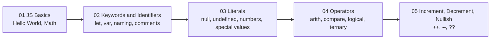

# Learn JavaScript Fundamentals with Playwright


A chapter-by-chapter JavaScript learning repository built for hands-on practice. Each folder is a topic, and each file is a small example you can run independently to understand how JavaScript works in real life.

---

## Table of Contents

- [Roadmap](#roadmap)
- [Chapter Summary](#chapter-summary)
- [Project Structure](#project-structure)
- [Getting Started](#getting-started)
- [Chapter 01: JavaScript Basics](#chapter-01-javascript-basics)
- [Chapter 02: Keywords and Identifiers](#chapter-02-keywords-and-identifiers)
- [Chapter 03: Literals](#chapter-03-literals)
- [Chapter 04: Operators](#chapter-04-operators)
- [Chapter 05: Increment, Decrement and Nullish](#chapter-05-increment-decrement-and-nullish)

---

## Roadmap



---

## Chapter Summary

This repository is organized in a simple learning flow from fundamentals to operator logic:

- `01_chapter_JS_Basics/` — Introduction to JavaScript output and basic arithmetic using small scripts.
- `02_chapter_JS_Keywrods_Identifiers/` — Understanding JavaScript engines, keywords, identifiers, naming rules, and comments.
- `03_chapter_JS_Literals/` — Working with number literals, `null`, `undefined`, and special values like `NaN` and `Infinity`.
- `04_chapter_JS_Operators/` — Practice with arithmetic, assignment, comparison, logical, and ternary operators.
- `05_chapter_JS_Increment_Decrement_op/` — Covering pre/post increment, pre/post decrement, and nullish coalescing with `??`.

---

## Project Structure

```text
Playwright/
├── 01_chapter_JS_Basics/
│   ├── 01_HelloWorld.js
│   └── 02_Math.js
├── 02_chapter_JS_Keywrods_Identifiers/
│   ├── 03_js_engine.js
│   ├── 04_let_engine.js
│   ├── 06_Keyword_identifier_Rules.js
│   ├── 07_identifier_Rules2.js
│   ├── 08_comments.js
│   └── 09_IQ.js
├── 03_chapter_JS_Literals/
│   ├── 10_Literal.js
│   ├── 11_Number.js
│   ├── 12_Null_Undefined.js
│   ├── 13_Null.js
│   ├── 14_Literals.js
│   ├── 15_Number.js
│   ├── 16_Number_Part2.js
│   ├── 17_Special.js
│   └── 18_Undefined.js
├── 04_chapter_JS_Operators/
│   ├── 19_Arith.js
│   ├── 20_Assigment_op.js
│   ├── 21_Arithematic_op.js
│   ├── 22_Comparsion_op.js
│   ├── 23_Logical_op.js
│   ├── 24_Confusing_comparsion.js
│   ├── 25_Confusing.js
│   ├── 26_Questions.js
│   ├── 27_String.js
│   ├── 28_Ternary_op.js
│   ├── 29_Ternary_op1.js
│   ├── 30_IQ.js
│   ├── 31_IQ.js
│   ├── 32_IQ.js
│   ├── 33_IQ.js
│   ├── 34_Nested_Ternary.js
│   ├── 35_IQ.js
│   ├── 36_IQ.js
│   └── 37_Typeof.js
├── 05_chapter_JS_Increment_Decrement_op/
│   ├── 38_Pre-Increment_op.js
│   ├── 39_Post-Increment_op.js
│   ├── 40_IQ.js
│   ├── 41_IQ.js
│   ├── 42_IQ.js
│   ├── 43_Pre-Decrement_op.js
│   ├── 44_Post-Decrement_op.js
│   └── 45_Nullish.js
├── .git/
├── README.md
└── .gitignore
```

---

## Getting Started

### Prerequisites

- Node.js installed on your machine
- Basic understanding of running JavaScript files in the terminal

### Run a file

```bash
node 01_chapter_JS_Basics/01_HelloWorld.js
node 04_chapter_JS_Operators/23_Logical_op.js
node 05_chapter_JS_Increment_Decrement_op/45_Nullish.js
```

### Suggested order

1. Start with `01_chapter_JS_Basics/`
2. Move to `02_chapter_JS_Keywrods_Identifiers/`
3. Practice `03_chapter_JS_Literals/`
4. Learn operator behavior in `04_chapter_JS_Operators/`
5. Finish with `05_chapter_JS_Increment_Decrement_op/`

---

## Chapter 01: JavaScript Basics

This section introduces JavaScript fundamentals using simple scripts.

- `01_HelloWorld.js` — prints output to the console
- `02_Math.js` — demonstrates arithmetic operations and basic calculations

**Focus:** syntax, output, and basic expressions.

---

## Chapter 02: Keywords and Identifiers

This chapter focuses on JavaScript declarations and naming rules.

- `03_js_engine.js` — understanding the JavaScript engine and execution flow
- `04_let_engine.js` — simple `let` example
- `06_Keyword_identifier_Rules.js` — identifier rules and invalid naming cases
- `07_identifier_Rules2.js` — naming conventions and best practices
- `08_comments.js` — single-line and block comments
- `09_IQ.js` — interview-style practice and quick checks

**Focus:** `var`, `let`, `const`, naming rules, comments, and code readability.

---

## Chapter 03: Literals

This chapter explores literal values and common JavaScript data types.

- `10_Literal.js` — basic literals
- `11_Number.js` — number literals and number behavior
- `12_Null_Undefined.js` — comparing `null` and `undefined`
- `13_Null.js` — null examples
- `14_Literals.js` — multiple literal examples
- `15_Number.js` — numeric values and representation
- `16_Number_Part2.js` — more number practice
- `17_Special.js` — special numeric values such as `Infinity` and `NaN`
- `18_Undefined.js` — `undefined` usage and behavior

**Focus:** values, type checks, and special cases in JavaScript.

---

## Chapter 04: Operators

This is one of the largest chapters and covers everyday JavaScript operator logic.

- `19_Arith.js` — arithmetic operators
- `20_Assigment_op.js` — assignment operators
- `21_Arithematic_op.js` — arithmetic practice
- `22_Comparsion_op.js` — comparison operators
- `23_Logical_op.js` — logical operators
- `24_Confusing_comparsion.js` — confusing comparisons
- `25_Confusing.js` — more logic-based comparison tasks
- `26_Questions.js` — interview-style operator questions
- `27_String.js` — string concatenation and operator use on strings
- `28_Ternary_op.js` — ternary operator basics
- `29_Ternary_op1.js` — shorthand conditional examples
- `30_IQ.js` to `36_IQ.js` — practical interview and reasoning questions
- `37_Typeof.js` — `typeof` checks

**Focus:** expressions, comparisons, conditional logic, and debugging operator behavior.

---

## Chapter 05: Increment, Decrement and Nullish

This chapter introduces operator behavior that often confuses beginners.

- `38_Pre-Increment_op.js` — pre-increment `++a`
- `39_Post-Increment_op.js` — post-increment `a++`
- `40_IQ.js`, `41_IQ.js`, `42_IQ.js` — increment-based interview questions
- `43_Pre-Decrement_op.js` — pre-decrement `--a`
- `44_Post-Decrement_op.js` — post-decrement `a--`
- `45_Nullish.js` — nullish coalescing with `??`

**Focus:** mutating values, order of evaluation, and safe null handling.

---

## Notes

- This repository is designed for learning through small, focused examples.
- The flow progresses from syntax and values to logic and operators.
- Each file is intentionally short so you can understand one idea at a time.
- Use each script as a practical reference while building your JavaScript foundation.
